# 🔍 GiftAI — Complete Website Audit & Business Analysis

> **Website**: AI Personalized Gift Platform  
> **Stack**: Next.js 16 (Frontend) + Express.js/Prisma/MongoDB (Backend)  
> **Date**: June 10, 2026  
> **Analysis Scope**: Design, UX/UI, Branding, SEO, Security, Performance, Conversion, Competitive Position

---

## Executive Summary

GiftAI is an AI-powered personalized gift platform with a compelling core value proposition — users upload a photo, choose an AI style (anime, cartoon, sketch, cyberpunk), and the system generates a personalized design that gets printed on physical products. **The concept is strong and has high market potential**, but the current implementation has **critical issues that will significantly hurt conversions, trust, and revenue**:

| Area | Score | Grade |
|------|-------|-------|
| Branding Consistency | 3/10 | 🔴 Critical |
| UX/UI Design Quality | 6/10 | 🟡 Needs Work |
| SEO Readiness | 2/10 | 🔴 Critical |
| Security Posture | 3/10 | 🔴 Critical |
| Mobile Responsiveness | 6/10 | 🟡 Adequate |
| Conversion Optimization | 4/10 | 🔴 Poor |
| Content Quality | 3/10 | 🔴 Critical |
| Trust & Social Proof | 3/10 | 🔴 Critical |
| Performance | 5/10 | 🟡 Average |
| Business Readiness | 3/10 | 🔴 Not Launch-Ready |

---

## 1. 🚨 CRITICAL: Branding Identity Crisis

> [!CAUTION]
> The website has a severe **brand identity conflict** that will confuse every visitor and destroy trust instantly.

### Problems Found

| Element | Shows | Should Show |
|---------|-------|-------------|
| [Navbar brand](file:///Users/sheabali/Project/AiPersonalizedGift/ai_personalized_gift_frontend/components/shared/Navbar.tsx#L9-L11) | **"CareerAI"** | "GiftAI" |
| [Footer brand](file:///Users/sheabali/Project/AiPersonalizedGift/ai_personalized_gift_frontend/components/shared/Footer.tsx#L19-L21) | **"CareerAI"** | "GiftAI" |
| [Footer description](file:///Users/sheabali/Project/AiPersonalizedGift/ai_personalized_gift_frontend/components/shared/Footer.tsx#L23-L26) | *"The ultimate AI resume analyzer"* | Gift platform description |
| [Footer copyright](file:///Users/sheabali/Project/AiPersonalizedGift/ai_personalized_gift_frontend/components/shared/Footer.tsx#L67) | *"© CareerAI. All rights reserved."* | "© GiftAI" |
| [Footer newsletter text](file:///Users/sheabali/Project/AiPersonalizedGift/ai_personalized_gift_frontend/components/shared/Footer.tsx#L50-L51) | *"career tips and product updates"* | Gift/design updates |
| [Navbar links](file:///Users/sheabali/Project/AiPersonalizedGift/ai_personalized_gift_frontend/components/shared/Navbar.tsx#L13-L37) | Features, How it Works, Pricing, FAQ | Products, AI Design, Collections |
| [404 page messaging](file:///Users/sheabali/Project/AiPersonalizedGift/ai_personalized_gift_frontend/src/app/not-found.tsx#L51) | *"AI analysis"* reference | Gift-related |
| `package.json` name | `"starter-pack-with-redux"` | `"giftai-frontend"` |
| Backend repo URL | `"backend-starter-pack"` | Project-specific |
| [404 support email](file:///Users/sheabali/Project/AiPersonalizedGift/ai_personalized_gift_frontend/src/app/not-found.tsx#L91) | `support@example.com` | Real support email |
| Redux API files | Contains `resumeApi.ts`, `feedbackApi.ts` | Leftover from CareerAI template |

**Business Impact**: 🔴 **DEVASTATING** — Visitors will see "CareerAI" in the navigation and "AI resume analyzer" in the footer while viewing gift products. This **instantly destroys credibility** and makes the business look unprofessional or fraudulent. **Expected conversion loss: 60-80%.**

---

## 2. 📐 UX/UI Design Analysis

### ✅ What's Working Well
- **Hero section** ([page.tsx](file:///Users/sheabali/Project/AiPersonalizedGift/ai_personalized_gift_frontend/src/app/(defaultLayout)/(home)/page.tsx#L29-L115)) — Beautiful visual hierarchy with strong CTA buttons, social proof (5,000+ happy customers), and animated background blobs
- **AI Design wizard** ([ai-design/page.tsx](file:///Users/sheabali/Project/AiPersonalizedGift/ai_personalized_gift_frontend/src/app/(defaultLayout)/ai-design/page.tsx)) — Intuitive 3-step process with progress indicator
- **Product cards** ([ProductCard.tsx](file:///Users/sheabali/Project/AiPersonalizedGift/ai_personalized_gift_frontend/components/module/Product/ProductCard.tsx)) — Clean design with hover effects, badges, wishlist button
- **Cart/Checkout flow** — Polished with smooth animations via Framer Motion
- **Color system** ([globals.css](file:///Users/sheabali/Project/AiPersonalizedGift/ai_personalized_gift_frontend/src/app/globals.css#L46-L86)) — Well-defined design tokens with primary `#6B5FD3` (purple), secondary `#1D9E75` (green), accent `#EF9F27` (gold)
- **Dark mode support** defined in CSS variables

### 🔴 Critical UX Issues

#### A. Navigation is completely wrong
The [Navbar](file:///Users/sheabali/Project/AiPersonalizedGift/ai_personalized_gift_frontend/components/shared/Navbar.tsx) has links to **Features, How it Works, Pricing, FAQ** — none of which exist on this platform. The actual pages (Products, AI Design, Cart, Orders) have **zero navigation links**.

- ❌ No link to Products page
- ❌ No link to Cart (no cart icon with item count)
- ❌ No user profile/avatar when logged in
- ❌ No mobile hamburger menu
- ❌ Both "Sign In" and "Get Started" point to `/login`

#### B. Missing critical pages
- ❌ No **About Us** page
- ❌ No **Contact** page (linked from footer but doesn't exist)
- ❌ No **Privacy Policy** page (linked but doesn't exist)
- ❌ No **Terms of Service** page (linked but doesn't exist)
- ❌ No **FAQ** page
- ❌ No **Pricing** page (linked but doesn't exist)
- ❌ No **Blog/Content** section
- ❌ No **Wishlist** page (heart button exists but is non-functional)
- ❌ No **Search results** page
- ❌ No **User profile edit** page
- ❌ No **Order tracking** detail page

#### C. Fake/hardcoded data

| Location | Issue |
|----------|-------|
| [Home page](file:///Users/sheabali/Project/AiPersonalizedGift/ai_personalized_gift_frontend/src/app/(defaultLayout)/(home)/page.tsx#L80) | "5,000+ Happy Customers" — fabricated |
| [Product detail](file:///Users/sheabali/Project/AiPersonalizedGift/ai_personalized_gift_frontend/src/app/(defaultLayout)/products/%5Bid%5D/page.tsx#L145) | "(128 customer reviews)" — hardcoded |
| [ProductCard](file:///Users/sheabali/Project/AiPersonalizedGift/ai_personalized_gift_frontend/components/module/Product/ProductCard.tsx#L93-L97) | All products show 5 stars (4.8) — hardcoded |
| Product categories | "Home Decor, Clothing, Accessories, Art Prints" — static, not from DB |
| Product filters | Sort/Filter/Grid/List buttons — all non-functional |
| Social proof avatars | From `pravatar.cc` — fake random avatars |

#### D. Missing Hero Image
The hero section references `/images/hero-gift.jpg` which may not exist, leading to a broken image on the most important section of the site.

---

## 3. 🔍 SEO Analysis

> [!WARNING]
> The website has almost **zero SEO optimization** and will be essentially invisible to search engines.

### Problems

| SEO Element | Status | Impact |
|-------------|--------|--------|
| **Page-level meta tags** | ❌ Only root layout has metadata | Each page needs unique title/description |
| **Product pages** | ❌ No dynamic meta tags | Products won't appear in Google Shopping |
| **Structured data (JSON-LD)** | ❌ Missing entirely | No rich snippets in search results |
| **Open Graph tags** | ❌ None | Social sharing will show generic previews |
| **Sitemap.xml** | ❌ Missing | Google can't crawl efficiently |
| **Robots.txt** | ❌ Missing | No crawl directives |
| **Canonical URLs** | ❌ Not set | Risk of duplicate content |
| **Alt text** | ⚠️ Generic ("User", "Gallery 0") | Poor image SEO |
| **H1 hierarchy** | ⚠️ Multiple H1s on some pages | Confuses crawlers |
| **URL structure** | ✅ Clean Next.js routes | Good foundation |
| **"use client" on all pages** | 🔴 All pages are client-rendered | Google may not index dynamic content |
| **Blog/content marketing** | ❌ None | No organic traffic potential |

**Business Impact**: 🔴 **The site will get near-zero organic traffic**. For an e-commerce gift platform, 40-60% of traffic typically comes from SEO. Missing this means complete dependence on paid ads.

---

## 4. 🔐 Security Audit

> [!CAUTION]
> Multiple **critical security vulnerabilities** that could lead to data breaches, financial loss, or regulatory penalties.

### Critical Vulnerabilities

#### A. Rate Limiting is a No-Op
The [rate limiter](file:///Users/sheabali/Project/AiPersonalizedGift/ai_personalized_gift_backend/src/app/middlewares/rateLimit.ts) literally does nothing:
```typescript
const rateLimit = async (req, res, next) => { next(); };
```
This means:
- ❌ Brute force attacks on login endpoint
- ❌ AI generation API abuse (each call costs money!)
- ❌ DDoS vulnerability
- ❌ Account enumeration attacks

#### B. Wildcard Image Domains
[next.config.ts](file:///Users/sheabali/Project/AiPersonalizedGift/ai_personalized_gift_frontend/next.config.ts#L7-L13) allows **ALL hostnames** with `hostname: "**"`:
```typescript
remotePatterns: [{ protocol: "http", hostname: "**" }, { protocol: "https", hostname: "**" }]
```
This enables **SSRF attacks** and loading malicious content through the Next.js image proxy.

#### C. JWT Token in Raw Cookie
The [frontend middleware](file:///Users/sheabali/Project/AiPersonalizedGift/ai_personalized_gift_frontend/middleware.ts#L21) reads JWT from `request.cookies.get("token")`, but there's no indication of:
- ❌ `HttpOnly` flag on cookie
- ❌ `Secure` flag for HTTPS
- ❌ `SameSite` attribute
- ❌ CSRF protection

#### D. Frontend JWT Decoding for Auth Decisions
The middleware uses `jwtDecode` (not verify!) to check admin roles. **Client-side JWT decode without verification** means any user can craft a token claiming admin role.

#### E. Backend Auth Issues
- The [auth middleware](file:///Users/sheabali/Project/AiPersonalizedGift/ai_personalized_gift_backend/src/app/middlewares/auth.ts#L11) reads token from `req.headers.authorization` without parsing `Bearer` prefix
- No token refresh mechanism visible
- JWT expiry set to only 2 hours with no silent refresh

#### F. Missing Security Headers
No evidence of:
- Content Security Policy (CSP)
- X-Frame-Options
- X-Content-Type-Options
- Strict-Transport-Security (HSTS)
- Helmet.js or equivalent

#### G. Open API Exposure
No API documentation protection, no API key requirement for public endpoints.

---

## 5. 📱 Mobile Responsiveness

### Issues Found

| Component | Issue |
|-----------|-------|
| **Navbar** | ❌ No mobile hamburger menu — nav links hidden on mobile with no alternative |
| **Product filters** | ❌ Sort/view toggles hidden on small screens |
| **Hero text** | ⚠️ `text-6xl md:text-7xl` may overflow on very small screens |
| **Checkout** | ⚠️ Two separate submit buttons (mobile/desktop) — duplicated logic |
| **Cart quantity controls** | ⚠️ Touch targets too small for mobile (3px padding on +/- buttons) |
| **Footer** | ⚠️ 4-column grid collapses to single column but newsletter form may be cramped |

---

## 6. 💰 Conversion Optimization

### Conversion Funnel Gaps

```mermaid
graph LR
    A["Homepage Visit"] --> B["Browse Products"]
    B --> C["Product Detail"]
    C --> D["AI Design"]
    D --> E["Cart"]
    E --> F["Checkout"]
    F --> G["Payment"]
    G --> H["Order Confirmation"]
    
    style A fill:#ef4444,color:#fff
    style B fill:#ef4444,color:#fff
    style C fill:#f59e0b,color:#fff
    style D fill:#22c55e,color:#fff
    style E fill:#f59e0b,color:#fff
    style F fill:#f59e0b,color:#fff
    style G fill:#ef4444,color:#fff
    style H fill:#ef4444,color:#fff
```



> 🔴 Red = Critical gaps | 🟡 Yellow = Needs improvement | 🟢 Green = Good

### Specific Issues

| Stage | Problem | Fix |
|-------|---------|-----|
| **Homepage → Products** | Nav doesn't link to products | Add Products link to nav |
| **Products → Detail** | No filters actually work, no pagination | Implement real filtering |
| **Detail → AI Design** | User must be logged in, but no clear messaging | Show "Login to personalize" prompt |
| **AI Design → Cart** | Works well | ✅ |
| **Cart → Checkout** | No guest checkout, login required | Add guest checkout option |
| **Checkout → Payment** | SSLCommerz only, no alternative payment | Add Stripe, bKash, COD |
| **Payment → Confirmation** | Only success/fail pages — no email confirmation visible | Add order confirmation email |
| **Post-Purchase** | No upsell, no cross-sell, no referral | Add related products, share links |

### Missing Conversion Elements
- ❌ **No urgency signals** — "X items left", countdown timers, limited edition tags
- ❌ **No coupon/promo code** field in cart or checkout
- ❌ **No abandoned cart recovery** — no email reminders
- ❌ **No recently viewed products** carousel
- ❌ **No customer reviews/testimonials** section (Review model exists in DB but no frontend!)
- ❌ **No "How it works" visual process** on homepage
- ❌ **No live chat/support widget**
- ❌ **No exit-intent popup** with discount offer
- ❌ **No email capture** beyond non-functional newsletter form
- ❌ **Newsletter signup** is fake — `console.log("Subscribed")` only

---

## 7. 🏢 Competitive Analysis

### Key Competitors in AI Personalized Gifts

| Feature | **GiftAI (You)** | **Shutterfly** | **Printful + AI** | **CustomInk** | **Canva Print** |
|---------|-----------------|----------------|-------------------|---------------|-----------------|
| AI Photo Styles | ✅ 4 styles | ❌ None | ⚠️ Limited | ❌ None | ⚠️ AI tools |
| Product Range | ⚠️ Unknown qty | ✅ 300+ | ✅ 200+ | ✅ 100+ | ✅ 50+ |
| Live Mockup Preview | ✅ Draggable | ✅ Static | ✅ 3D | ✅ Static | ✅ Static |
| Guest Checkout | ❌ | ✅ | ✅ | ✅ | ✅ |
| Social Login | ❌ | ✅ | ✅ | ✅ | ✅ |
| Reviews System | ❌ (DB only) | ✅ | ✅ | ✅ | ✅ |
| Multiple Payment | ⚠️ SSLCommerz | ✅ All | ✅ All | ✅ All | ✅ All |
| Order Tracking | ⚠️ Basic | ✅ Full | ✅ Full | ✅ Full | ✅ Full |
| Mobile App | ❌ | ✅ | ❌ | ✅ | ✅ |
| SEO/Blog | ❌ | ✅ | ✅ | ✅ | ✅ |

### Your Unique Advantage 🎯
**AI-generated art styles (anime, cartoon, cyberpunk, sketch) applied to gift products is genuinely unique** in the market. No major competitor offers this end-to-end. This is your **moat** — but it needs much better packaging and presentation.

---

## 8. ⚡ Performance Analysis

### Issues

| Area | Finding |
|------|---------|
| **Client-side rendering** | Every page uses `"use client"` — no SSR/SSG benefits |
| **Bundle size** | Heavy dependencies: `three.js` (181KB+), `konva`, `recharts`, `lottie-react` loaded globally |
| **Image optimization** | Using `next/image` ✅ but wildcard domains and no `priority` hints |
| **No lazy loading** | Components like Konva canvas, Lottie should be dynamically imported |
| **Redux persistence** | Using `redux-persist` — good for cart, but no selectivity visible |
| **No caching strategy** | No ISR, no stale-while-revalidate on product listings |
| **Unused dependencies** | `three` (Three.js), `form`, `hook` — likely unused bloat |

---

## 9. 📊 Prioritized Action Plan

### 🔴 HIGH PRIORITY (Week 1-2) — Do Immediately

| # | Action | Impact | Effort |
|---|--------|--------|--------|
| 1 | **Fix all branding** — Replace every "CareerAI" with "GiftAI", update descriptions, emails, links | Trust +80% | 2 hours |
| 2 | **Fix Navbar** — Add Products, Cart (with count badge), user avatar dropdown, mobile menu | Navigation +90% | 1 day |
| 3 | **Implement rate limiting** — Use `express-rate-limit` on auth and AI endpoints | Security: Critical | 2 hours |
| 4 | **Fix image domain wildcards** — Whitelist only your CDN domains | Security: Critical | 30 min |
| 5 | **Add working product filters** — Category, price range, sort functionality | Conversion +25% | 2 days |
| 6 | **Create missing legal pages** — Privacy Policy, Terms of Service, Contact | Trust & Legal compliance | 1 day |
| 7 | **Fix newsletter form** — Connect to backend or Mailchimp/Resend | Lead capture enabled | 4 hours |
| 8 | **Add page-specific SEO** — Dynamic meta titles, descriptions for all routes | SEO foundation | 1 day |
| 9 | **Remove fake data** — Replace hardcoded reviews/stats with real data or remove | Trust +50% | 3 hours |
| 10 | **Add security headers** — Install `helmet`, configure CSP | Security baseline | 2 hours |

### 🟡 MEDIUM PRIORITY (Week 3-4)

| # | Action | Impact | Effort |
|---|--------|--------|--------|
| 11 | **Build Reviews UI** — Show product reviews (model exists in Prisma) | Conversion +15-20% | 2 days |
| 12 | **Add "How It Works" section** — Visual 3-step process on homepage | Conversion +10% | 4 hours |
| 13 | **Implement wishlist** — Make heart buttons functional with persisted state | Engagement +20% | 1 day |
| 14 | **Add guest checkout** — Allow purchasing without mandatory registration | Conversion +30% | 1 day |
| 15 | **Add structured data (JSON-LD)** — Product, Organization, BreadcrumbList schemas | SEO rich snippets | 1 day |
| 16 | **Order confirmation emails** — Use Nodemailer (already installed) to send receipts | Trust +40% | 1 day |
| 17 | **Add coupon/promo code** functionality | Revenue tool | 2 days |
| 18 | **Implement pagination** on product listing | UX + Performance | 4 hours |
| 19 | **Add sitemap.xml and robots.txt** | SEO crawling | 2 hours |
| 20 | **SSR for product pages** — Convert to server components for SEO | SEO indexing +50% | 1 day |

### 🟢 LOW PRIORITY (Month 2+)

| # | Action | Impact | Effort |
|---|--------|--------|--------|
| 21 | **Add social login** — Google, Facebook OAuth | Registration +25% | 2 days |
| 22 | **Blog/content section** — Gift guides, AI art tutorials | SEO organic traffic | 3 days |
| 23 | **Abandoned cart emails** — Trigger after X hours of inactivity | Revenue recovery 5-15% | 2 days |
| 24 | **Add more AI styles** — Oil painting, watercolor, pop art, Ghibli | Product value +30% | 3 days |
| 25 | **Live chat widget** — Integrate Tawk.to or Crisp | Support + conversion +5% | 2 hours |
| 26 | **Referral program** — Share & earn discounts | Organic growth +10% | 3 days |
| 27 | **PWA support** — Installable web app | Mobile engagement +15% | 1 day |
| 28 | **Performance audit** — Remove Three.js, lazy-load Konva, optimize bundles | Load time -40% | 2 days |
| 29 | **Multiple payment gateways** — Add Stripe for international, bKash for local | Market reach +30% | 2 days |
| 30 | **A/B testing framework** — Test CTA copy, colors, layouts | Data-driven optimization | 2 days |

---

## 10. 🛠️ Recommended Tools & Integrations

| Category | Tool | Purpose |
|----------|------|---------|
| **Email Marketing** | Resend or Mailchimp | Transactional + marketing emails |
| **Analytics** | PostHog or Mixpanel | Funnel analytics, heatmaps |
| **Live Chat** | Tawk.to (free) or Crisp | Real-time customer support |
| **SEO** | next-sitemap + next-seo | Automated sitemaps and meta tags |
| **Security** | Helmet.js + express-rate-limit | Security headers + rate limiting |
| **Error Tracking** | Sentry | Frontend + backend error monitoring |
| **Performance** | Vercel Analytics (already installed!) | Core Web Vitals monitoring |
| **A/B Testing** | GrowthBook or Statsig | Feature flags + experiments |
| **Social Proof** | Real reviews or Trustpilot widget | Authentic trust signals |
| **Payments** | Stripe (international) + bKash API | Broader payment coverage |
| **Image CDN** | Cloudinary (already used) or Imgix | Optimized image delivery |
| **CMS for Blog** | Contentlayer or Sanity | Content marketing platform |

---

## 11. 💡 Revenue-Boosting Features to Add

### Quick Wins
1. **"Design for Someone" flow** — Gift-sending UX where sender pays and recipient gets delivery
2. **Bulk order / Corporate gifts** — Add a "Team Orders" landing page for businesses
3. **Gift cards** — Digital gift cards for the platform
4. **"Before & After" gallery** — Showcase AI transformations as social proof
5. **Real-time design preview** — Show AI result on the actual product mockup (partially exists)

### Advanced Features
6. **AI style suggestions** — "Based on your photo, we recommend Anime Style" 
7. **Multi-face detection** — Group photos → group gift items
8. **Custom text overlay** — Add names, dates, messages to designs
9. **Design history** — Users can re-order past designs
10. **Subscription box** — Monthly personalized gift delivery

---

## 12. Summary: What to Do First

> [!IMPORTANT]
> **Before any marketing spend or public launch, fix these 5 things:**

1. ✅ **Fix ALL "CareerAI" branding** → takes 2 hours, eliminates #1 trust killer
2. ✅ **Rebuild the Navbar** → add Products, Cart icon, user menu, mobile menu
3. ✅ **Implement rate limiting** → protect your AI API from abuse (costs you money!)
4. ✅ **Fix wildcard image domains** → close SSRF security hole
5. ✅ **Remove or replace fake social proof** → fake reviews destroy trust

These 5 changes alone can transform the site from "looks like a template" to "looks like a real business" — and they can all be done in **one focused weekend**.

---

*Analysis prepared as a combined assessment from Business Strategy, UX Design, SEO, Security, and CRO perspectives.*
