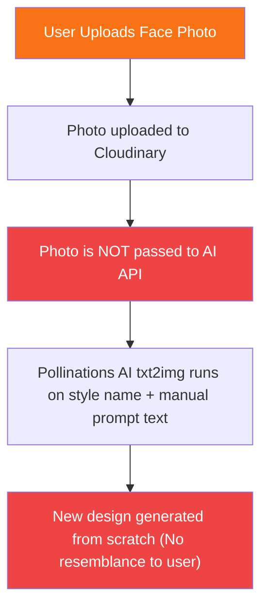

# 🛒 GiftAI — E-commerce & AI Pipeline Improvement Analysis

We analyzed the current codebase of the **GiftAI** platform (frontend and backend) to identify feature gaps, technical limitations, and user experience issues. 

Below is the detailed improvement roadmap to elevate the platform from a basic prototype to a high-converting, fully functional, and secure **AI-powered personalization engine**.

---

## 🧠 1. Core AI Customization Pipeline (The Magic Factor)

Currently, the AI generation pipeline has a critical mismatch between what is promised to the user and what the code actually does.



### 🔴 The Issue: Text-to-Image instead of Image-to-Image (img2img)
The backend service (`ai.service.ts`) uses a free service called **Pollinations AI** (`https://image.pollinations.ai`). This service only supports **text-to-image** generation. 
The uploaded user photo is completely ignored during image generation. The AI simply draws a new person or character from scratch based on the text prompt, which defeats the core business proposition of creating **personalized** gifts.

### 🛠️ The Fix: Real Image-to-Image Stylization
To make the AI stylized art look like the user, we should implement true **image-to-image (img2img)** generation or **Face Swap** using the existing Replicate and Stability AI packages which are already installed:
1. **Replicate Pipeline**:
   - Use models like **ControlNet**, **InstantID**, or **IP-Adapter** on Replicate (e.g., `tencentarc/photomaker` or `lucataco/faceswap`).
   - Pass the `originalImage` URL (Cloudinary link) directly into the Replicate API inputs.
2. **Stability AI Pipeline**:
   - Utilize Stability AI's **Image-to-Image** endpoint (`/v2beta/stable-image/generate/image-to-image`) or their **Sketch** endpoint, passing the original image alongside the style prompt.

---

## 🛒 2. E-Commerce UX & Navigation Enhancements

While many static pages have been added, the core e-commerce shopping flow is missing standard industry features.

### A. Dynamic Search, Filtering, and Sorting
- **Current State**: The backend (`product.service.ts`) supports search, categories, price range, and tags. However, the frontend (`products/page.tsx`) features static filters that are not hooked up to the API.
- **Improvement**: Connect the sidebar filter components (Category, Price Slider, Sorting Dropdown) to Next.js query parameters and dynamically trigger `useGetAllProductsQuery(filters)` on the frontend.

### B. Functional Wishlist System
- **Current State**: Clicking the Heart icon on product cards calls the `toggleWishlist` API, but:
  - There is no navbar link to see the wishlist.
  - The wishlist page `/user/wishlist` does not display a grid of saved products properly.
- **Improvement**: Add a heart/wishlist icon to the main Navbar layout showing the current count of wishlisted items and link it to `/user/wishlist`.

### C. Stripe International Payment Option
- **Current State**: The checkout page only provides SSLCommerz (mainly for Bangladesh local currency BDT). The Stripe library is installed in package.json but not integrated into the checkout flow.
- **Improvement**: Create a tabbed payment interface on the checkout page allowing users to choose **bKash/SSLCommerz (Local)** or **Stripe / Credit Card (International)**.

---

## ⚙️ 3. Technical & Performance Optimization

### A. Dynamic Sitemap Rendering
- **Current State**: The `sitemap.ts` file attempts to fetch products dynamically during the Next.js static build phase, resulting in a `DYNAMIC_SERVER_USAGE` build warning/error.
- **Improvement**: Change `/sitemap.xml` to fetch with revalidation or export a static sitemap config with fallback dynamics:
  ```typescript
  export const revalidate = 3600; // Cache sitemap for 1 hour
  ```

### B. Next.js Middleware Role-Bypassing Vulnerability
- **Current State**: The frontend `middleware.ts` checks user roles by client-side decoding (`jwtDecode`). A malicious user could craft a client cookie claiming admin role to bypass frontend routing.
- **Improvement**: Always verify the JWT token integrity using `jose` (`jwtVerify`) in the middleware using the server's `JWT_SECRET` instead of just decoding it.

### C. ESLint Code Cleanup
- **Current State**: The frontend build contains 210 style errors/warnings.
- **Improvement**: Run a clean script to eliminate unused imports (e.g. `AnimatePresence`, `Star`, `User`), type `any` occurrences, and escape unescaped apostrophes (`'`) in pages.

---

## 📊 4. Prioritized Action Plan for Improvements

| Improvement | Priority | Impact | Effort | Files to Modify |
|:---|:---:|:---:|:---:|:---|
| **True img2img Generator** | 🔴 High | 🚀 Critical | 1-2 Days | [ai.service.ts](file:///Users/sheabali/Project/AiPersonalizedGift/ai_personalized_gift_backend/src/app/modules/AiDesign/ai.service.ts) |
| **Fix Groq Vision Model** | 🔴 High | 🚀 Critical | 2 Hours | [ai.service.ts](file:///Users/sheabali/Project/AiPersonalizedGift/ai_personalized_gift_backend/src/app/modules/AiDesign/ai.service.ts) |
| **Frontend Filters Integration** | 🟡 Medium | 📈 High | 1 Day | [products/page.tsx](file:///Users/sheabali/Project/AiPersonalizedGift/ai_personalized_gift_frontend/src/app/(defaultLayout)/products/page.tsx) |
| **Stripe Payment Gateway** | 🟡 Medium | 📈 High | 1-2 Days | [checkout/page.tsx](file:///Users/sheabali/Project/AiPersonalizedGift/ai_personalized_gift_frontend/src/app/(defaultLayout)/checkout/page.tsx) |
| **Wishlist Navbar Icon & Page** | 🟢 Low | 📉 Medium | 4 Hours | [Navbar.tsx](file:///Users/sheabali/Project/AiPersonalizedGift/ai_personalized_gift_frontend/components/shared/Navbar.tsx) |
| **Sitemap Revalidation Fix** | 🟢 Low | 📉 Low | 30 Mins | [sitemap.ts](file:///Users/sheabali/Project/AiPersonalizedGift/ai_personalized_gift_frontend/src/app/sitemap.ts) |
| **ESLint Warnings Clean Up** | 🟢 Low | 📉 Low | 3 Hours | Multiple |
